# Recette — billets de train WhatsApp

Parcours fictif. Aucun envoi réel. Les textes sont ceux du CRM, variables remplies.

Ordre : aller, tarif, retour s’il y en a un, classe, récapitulatif. Tutoiement, prénom seul. On n’achète qu’après ton ok, dit seulement au récap.
Horaires proposés par défaut : aller à partir de 8h, retour à partir de 16h. Dates déduites de l’hôtel (lundi → mardi : aller lundi, retour mardi), modifiables.
Paiement : `creer_carte_pliant` sur le dossier, `trois_ds` faux. Le numéro n’est pas dans ces messages.
Tutoiement, prénom seul. Aller, puis tarif, puis retour s’il y en a un, puis classe. Dans la fenêtre de 24 h, une liste : chaque ligne est l’heure de départ (08h12), plus Autres horaires. Le train choisi est l’id (train:aller:0). Hors fenêtre, un court modèle « Voir les horaires » ouvre la session, puis la liste part. Un numéro tapé ne choisit pas le train.
Au moins 3 trains par sens, 9 au plus (10 boutons avec Autres horaires). L’envoi utilise le content SID `TWILIO_CONTENT_TRAIN_HORAIRES_N`, puis les modèles des étapes et `TWILIO_CONTENT_TRAIN_BILLET` le matin.

## Lancer la demande dans le CRM

Même bouton que la fiche dossier. Avant et après chaque hôtel, une carte en pointillés : + Ajouter une étape. Le clic propose Train, actif, et Avion, bientôt. Aperçu local, données fictives, sans écriture en base : `/apercu/demande-train`.

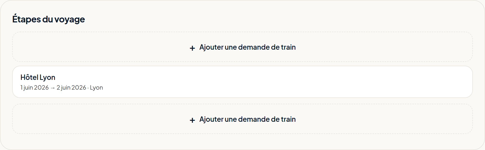

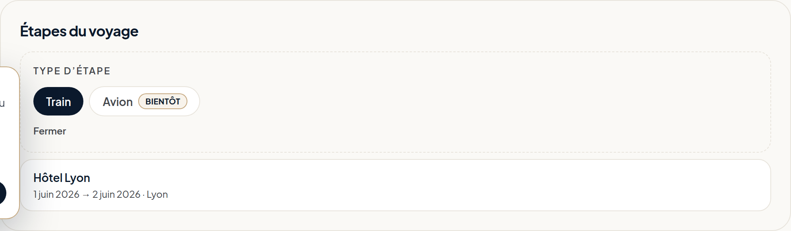

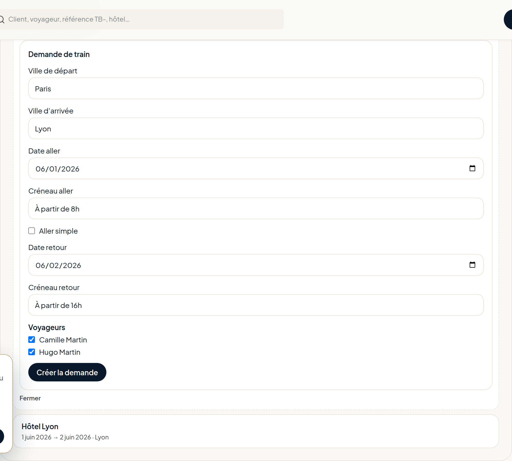

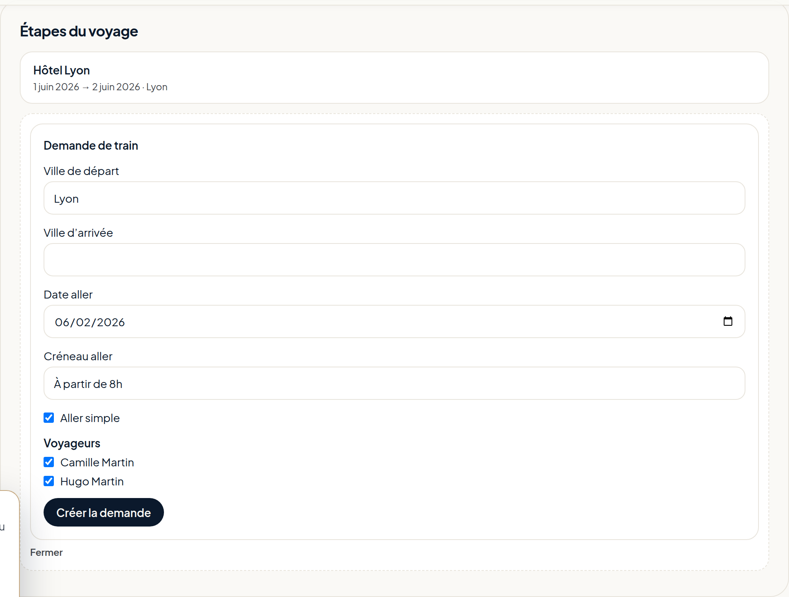

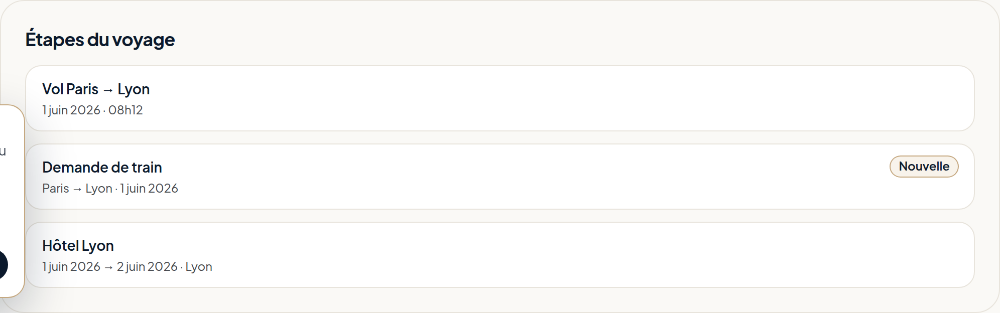

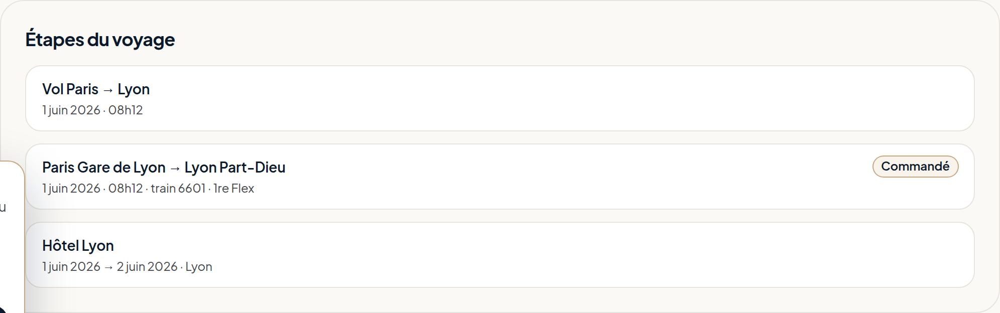

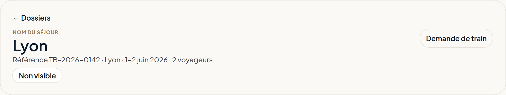

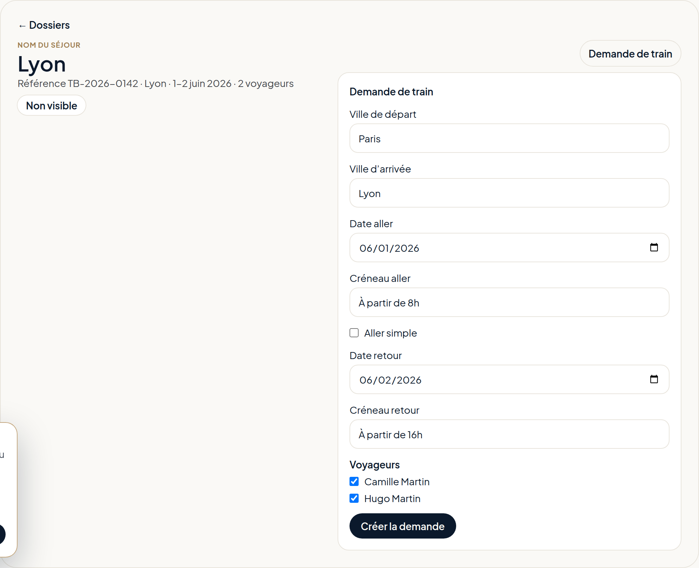

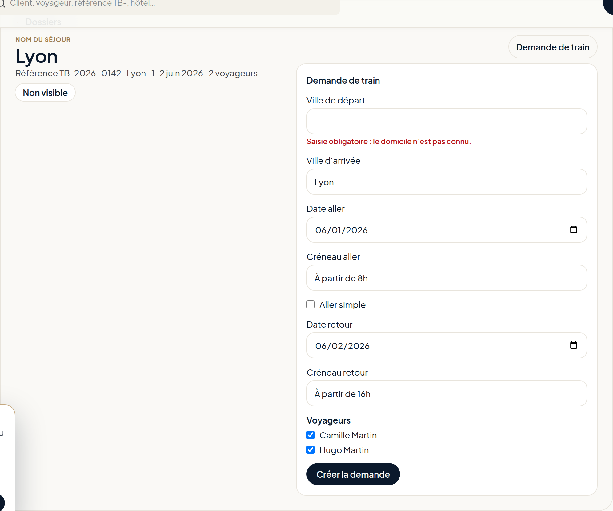

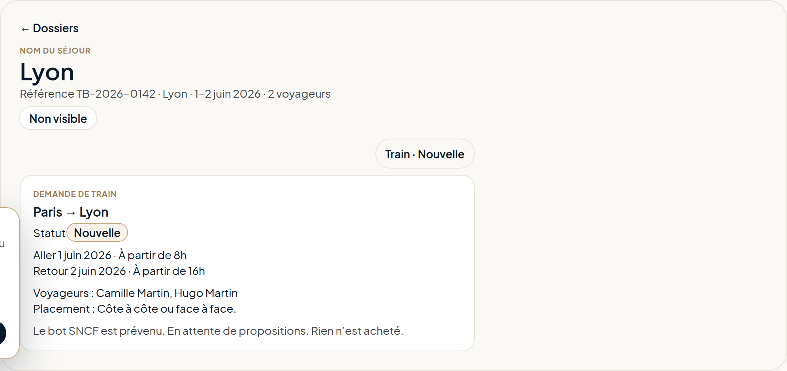

Les fils ci-dessous sont des images. Chaque fichier est dans `docs/recette-billets-train/`.

## Modèles

| Nom | Rôle |
| --- | --- |
| `train_horaires_aller_3` à `_9` et `train_horaires_retour_3` à `_9` | Liste en session, titre = heure de départ, plus Autres horaires |
| `train_accroche` | Hors fenêtre : bouton Voir les horaires, sans accolade |
| `train_classe` | Boutons 2de classe / 1re classe |
| `train_tarif` | Boutons Non remboursable / Flex |
| `train_accord` | Récapitulatif, Je confirme / Modifier / Je refuse |
| `train_modifier` | Le train / La classe / Le tarif |
| `train_billet` | PDF le matin du départ |

Une réponse incompréhensible repose la question une fois, puis la main passe à l’agence.
« Autres horaires », « plus tôt » ou « plus tard » renvoie la contrainte au bot SNCF.
Un délai (« je réfléchis ») garde les choix. À la relance, le bot resimule et le client confirme le nouveau prix.

## Aller simple, 1 voyageur

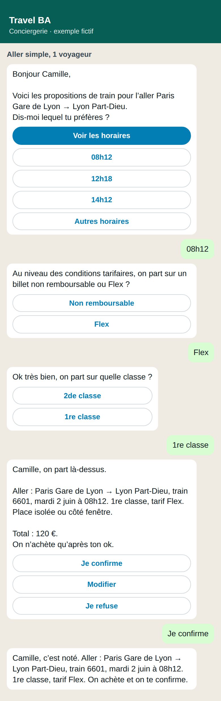

Voyageurs : Camille Martin

Placement : Place isolée ou côté fenêtre.

### 1. Propositions envoyées

Bot SNCF : Le bot a déposé les trains aller. Il attend.

**Agence**

Bonjour Camille,

Voici les propositions de train pour l’aller Paris Gare de Lyon → Lyon Part-Dieu.
Dis-moi lequel tu préfères ?

Liste : Voir les horaires

Lignes : 08h12 · 12h18 · 14h12 · Autres horaires

### 2. Propositions envoyées

Bot SNCF : Rien. Le client choisit encore.

**Client**

08h12

**Agence**

Au niveau des conditions tarifaires, on part sur un billet non remboursable ou Flex ?

Lignes : Non remboursable · Flex

### 3. Propositions envoyées

Bot SNCF : Rien.

**Client**

Flex

**Agence**

Ok très bien, on part sur quelle classe ?

Lignes : 2de classe · 1re classe

### 4. Propositions envoyées

Bot SNCF : Récap. L’achat attend l’ok.

**Client**

1re classe

**Agence**

Camille, on part là-dessus.

Aller : Paris Gare de Lyon → Lyon Part-Dieu, train 6601, mardi 2 juin à 08h12. 1re classe, tarif Flex. Place isolée ou côté fenêtre.

Total : 120 €.
On n’achète qu’après ton ok.

Lignes : Je confirme · Modifier · Je refuse

### 5. Choix reçu

Bot SNCF : Le bot achète le 6601 en 1re Flex, carte Pliant du dossier, sans 3DS.

**Client**

Je confirme

**Agence**

Camille, c’est noté. Aller : Paris Gare de Lyon → Lyon Part-Dieu, train 6601, mardi 2 juin à 08h12. 1re classe, tarif Flex. On achète et on te confirme.

## Aller-retour, 2 voyageurs

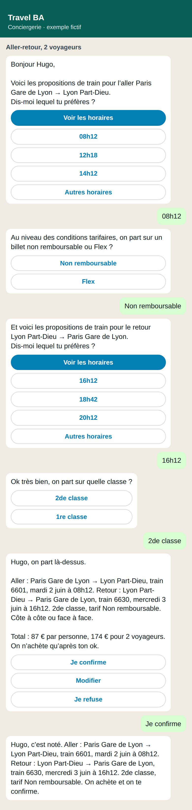

Voyageurs : Hugo Bernard et Inès Bernard

Placement : Côte à côte ou face à face.

### 1. Propositions envoyées

Bot SNCF : Le bot a déposé l’aller et le retour pour Hugo Bernard et Inès Bernard. Placement transmis : Côte à côte ou face à face.

**Agence**

Bonjour Hugo,

Voici les propositions de train pour l’aller Paris Gare de Lyon → Lyon Part-Dieu.
Dis-moi lequel tu préfères ?

Liste : Voir les horaires

Lignes : 08h12 · 12h18 · 14h12 · Autres horaires

### 2. Propositions envoyées

Bot SNCF : Pas d’achat.

**Client**

08h12

**Agence**

Au niveau des conditions tarifaires, on part sur un billet non remboursable ou Flex ?

Lignes : Non remboursable · Flex

### 3. Propositions envoyées

Bot SNCF : Pas d’achat.

**Client**

Non remboursable

**Agence**

Et voici les propositions de train pour le retour Lyon Part-Dieu → Paris Gare de Lyon.
Dis-moi lequel tu préfères ?

Liste : Voir les horaires

Lignes : 16h12 · 18h42 · 20h12 · Autres horaires

### 4. Propositions envoyées

Bot SNCF : Pas d’achat.

**Client**

16h12

**Agence**

Ok très bien, on part sur quelle classe ?

Lignes : 2de classe · 1re classe

### 5. Propositions envoyées

Bot SNCF : Pas d’achat.

**Client**

2de classe

**Agence**

Hugo, on part là-dessus.

Aller : Paris Gare de Lyon → Lyon Part-Dieu, train 6601, mardi 2 juin à 08h12. Retour : Lyon Part-Dieu → Paris Gare de Lyon, train 6630, mercredi 3 juin à 16h12. 2de classe, tarif Non remboursable. Côte à côte ou face à face.

Total : 87 € par personne, 174 € pour 2 voyageurs.
On n’achète qu’après ton ok.

Lignes : Je confirme · Modifier · Je refuse

### 6. Choix reçu

Bot SNCF : Le bot achète les deux trains, carte Pliant du dossier, sans 3DS, places selon la préférence.

**Client**

Je confirme

**Agence**

Hugo, c’est noté. Aller : Paris Gare de Lyon → Lyon Part-Dieu, train 6601, mardi 2 juin à 08h12. Retour : Lyon Part-Dieu → Paris Gare de Lyon, train 6630, mercredi 3 juin à 16h12. 2de classe, tarif Non remboursable. On achète et on te confirme.

## Famille de 4, avec enfants

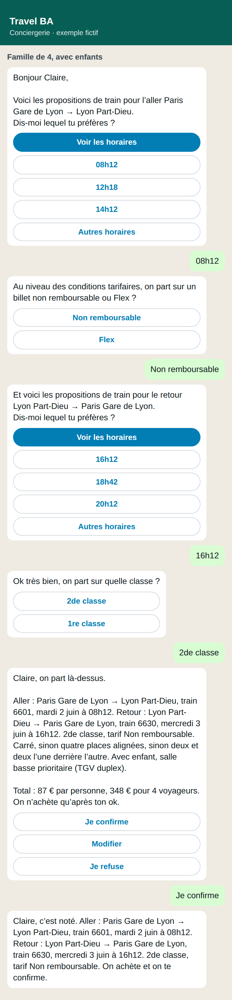

Voyageurs : Claire Morel, Marc Morel, Léa Morel (8 ans), Tom Morel (5 ans)

Placement : Carré, sinon quatre places alignées, sinon deux et deux l’une derrière l’autre. Avec enfant, salle basse prioritaire (TGV duplex).

### 1. Propositions envoyées

Bot SNCF : Le bot a déposé l’aller et le retour pour Claire Morel, Marc Morel, Léa Morel (8 ans), Tom Morel (5 ans). Placement transmis : Carré, sinon quatre places alignées, sinon deux et deux l’une derrière l’autre. Avec enfant, salle basse prioritaire (TGV duplex).

**Agence**

Bonjour Claire,

Voici les propositions de train pour l’aller Paris Gare de Lyon → Lyon Part-Dieu.
Dis-moi lequel tu préfères ?

Liste : Voir les horaires

Lignes : 08h12 · 12h18 · 14h12 · Autres horaires

### 2. Propositions envoyées

Bot SNCF : Pas d’achat.

**Client**

08h12

**Agence**

Au niveau des conditions tarifaires, on part sur un billet non remboursable ou Flex ?

Lignes : Non remboursable · Flex

### 3. Propositions envoyées

Bot SNCF : Pas d’achat.

**Client**

Non remboursable

**Agence**

Et voici les propositions de train pour le retour Lyon Part-Dieu → Paris Gare de Lyon.
Dis-moi lequel tu préfères ?

Liste : Voir les horaires

Lignes : 16h12 · 18h42 · 20h12 · Autres horaires

### 4. Propositions envoyées

Bot SNCF : Pas d’achat.

**Client**

16h12

**Agence**

Ok très bien, on part sur quelle classe ?

Lignes : 2de classe · 1re classe

### 5. Propositions envoyées

Bot SNCF : Pas d’achat.

**Client**

2de classe

**Agence**

Claire, on part là-dessus.

Aller : Paris Gare de Lyon → Lyon Part-Dieu, train 6601, mardi 2 juin à 08h12. Retour : Lyon Part-Dieu → Paris Gare de Lyon, train 6630, mercredi 3 juin à 16h12. 2de classe, tarif Non remboursable. Carré, sinon quatre places alignées, sinon deux et deux l’une derrière l’autre. Avec enfant, salle basse prioritaire (TGV duplex).

Total : 87 € par personne, 348 € pour 4 voyageurs.
On n’achète qu’après ton ok.

Lignes : Je confirme · Modifier · Je refuse

### 6. Choix reçu

Bot SNCF : Le bot achète les deux trains, carte Pliant du dossier, sans 3DS, places selon la préférence.

**Client**

Je confirme

**Agence**

Claire, c’est noté. Aller : Paris Gare de Lyon → Lyon Part-Dieu, train 6601, mardi 2 juin à 08h12. Retour : Lyon Part-Dieu → Paris Gare de Lyon, train 6630, mercredi 3 juin à 16h12. 2de classe, tarif Non remboursable. On achète et on te confirme.

## Autres horaires, plus tôt ou plus tard

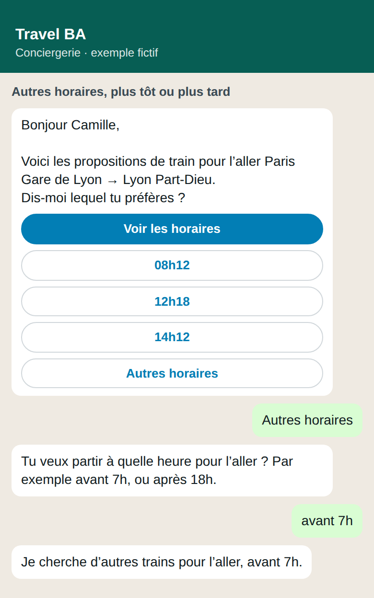

Voyageurs : Camille Martin

Placement : Place isolée ou côté fenêtre.

### 1. Propositions envoyées

Bot SNCF : Le bot a déposé les trains à partir de 8h et 16h.

**Agence**

Bonjour Camille,

Voici les propositions de train pour l’aller Paris Gare de Lyon → Lyon Part-Dieu.
Dis-moi lequel tu préfères ?

Liste : Voir les horaires

Lignes : 08h12 · 12h18 · 14h12 · Autres horaires

### 2. Propositions envoyées

Bot SNCF : La ligne Autres horaires est cliquée. Le CRM demande le créneau, sans recherche encore.

**Client**

Autres horaires

**Agence**

Tu veux partir à quelle heure pour l’aller ? Par exemple avant 7h, ou après 18h.

### 3. Recherche en cours

Bot SNCF : Le bot relance une recherche aller avant 7h. Il ne commande pas.

**Client**

avant 7h

**Agence**

Je cherche d’autres trains pour l’aller, avant 7h.

### 4. Recherche en cours

Bot SNCF : Même geste pour le retour : la ligne Autres horaires, puis « après 19h ».

## Le client change de classe ou de tarif au récapitulatif

Voyageurs : Camille Martin

Placement : Place isolée ou côté fenêtre.

### 1. Propositions envoyées

Bot SNCF : Trains déposés.

**Agence**

Bonjour Camille,

Voici les propositions de train pour l’aller Paris Gare de Lyon → Lyon Part-Dieu.
Dis-moi lequel tu préfères ?

Liste : Voir les horaires

Lignes : 08h12 · 12h18 · 14h12 · Autres horaires

### 2. Propositions envoyées

Bot SNCF : Pas d’achat.

**Client**

08h12

**Agence**

Au niveau des conditions tarifaires, on part sur un billet non remboursable ou Flex ?

Lignes : Non remboursable · Flex

### 3. Propositions envoyées

Bot SNCF : Pas d’achat.

**Client**

Flex

**Agence**

Ok très bien, on part sur quelle classe ?

Lignes : 2de classe · 1re classe

### 4. Propositions envoyées

Bot SNCF : Pas d’achat.

**Client**

1re classe

**Agence**

Camille, on part là-dessus.

Aller : Paris Gare de Lyon → Lyon Part-Dieu, train 6601, mardi 2 juin à 08h12. 1re classe, tarif Flex. Place isolée ou côté fenêtre.

Total : 120 €.
On n’achète qu’après ton ok.

Lignes : Je confirme · Modifier · Je refuse

### 5. Propositions envoyées

Bot SNCF : Pas d’achat. Le client change la classe.

**Client**

Modifier

**Agence**

Tu veux changer quoi ?

Lignes : Le train · La classe · Le tarif

### 6. Propositions envoyées

Bot SNCF : Rien.

**Client**

La classe

**Agence**

Ok très bien, on part sur quelle classe ?

Lignes : 2de classe · 1re classe

### 7. Propositions envoyées

Bot SNCF : Nouveau récap. L’achat attend encore l’ok.

**Client**

2de classe

**Agence**

Camille, on part là-dessus.

Aller : Paris Gare de Lyon → Lyon Part-Dieu, train 6601, mardi 2 juin à 08h12. 2de classe, tarif Flex. Place isolée ou côté fenêtre.

Total : 72 €.
On n’achète qu’après ton ok.

Lignes : Je confirme · Modifier · Je refuse

## Texte libre ou réponse incompréhensible

Voyageurs : Camille Martin

Placement : Place isolée ou côté fenêtre.

### 1. Propositions envoyées

Bot SNCF : Trains déposés.

**Agence**

Bonjour Camille,

Voici les propositions de train pour l’aller Paris Gare de Lyon → Lyon Part-Dieu.
Dis-moi lequel tu préfères ?

Liste : Voir les horaires

Lignes : 08h12 · 12h18 · 14h12 · Autres horaires

### 2. Propositions envoyées

Bot SNCF : Rien. La question est reposée.

**Client**

bof le truc

**Agence**

J’ai pas bien compris. Dis-moi l’horaire de l’aller, ou Autres horaires.

### 3. Propositions envoyées

Bot SNCF : La main passe à l’agence. Le bot n’achète pas.

**Client**

heu

**Agence**

Je passe le message à l’agence. Quelqu’un reprend avec toi.

## Aucune réponse, puis relance avec un prix plus élevé

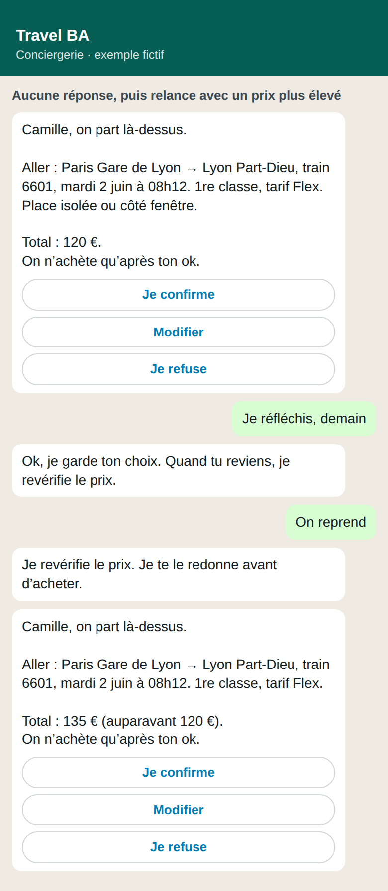

Voyageurs : Camille Martin

Placement : Place isolée ou côté fenêtre.

### 1. Propositions envoyées

Bot SNCF : Récapitulatif envoyé. Pas de réponse : la demande reste en propositions, les choix restent.

**Agence**

Camille, on part là-dessus.

Aller : Paris Gare de Lyon → Lyon Part-Dieu, train 6601, mardi 2 juin à 08h12. 1re classe, tarif Flex. Place isolée ou côté fenêtre.

Total : 120 €.
On n’achète qu’après ton ok.

Lignes : Je confirme · Modifier · Je refuse

### 2. En attente

Bot SNCF : Le bot n’achète pas. Les choix restent enregistrés.

**Client**

Je réfléchis, demain

**Agence**

Ok, je garde ton choix. Quand tu reviens, je revérifie le prix.

### 3. Prix à reconfirmer

Bot SNCF : Le bot refait une simulation SNCF.

**Client**

On reprend

**Agence**

Je revérifie le prix. Je te le redonne avant d’acheter.

### 4. Propositions envoyées

Bot SNCF : Le bot a renvoyé le prix augmenté. Le CRM redemande l’accord. Sans « Je confirme », pas d’achat.

**Agence**

Camille, on part là-dessus.

Aller : Paris Gare de Lyon → Lyon Part-Dieu, train 6601, mardi 2 juin à 08h12. 1re classe, tarif Flex.

Total : 135 € (auparavant 120 €).
On n’achète qu’après ton ok.

Lignes : Je confirme · Modifier · Je refuse

## Train complet ou plus disponible au moment d’acheter

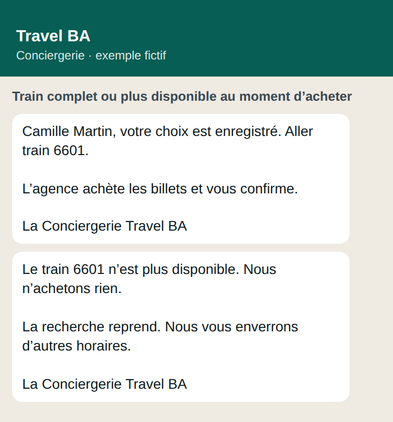

Voyageurs : Camille Martin

Placement : Place isolée ou côté fenêtre.

### 1. Choix reçu

Bot SNCF : Le bot tente l’achat et voit que le 6601 est complet.

**Agence**

Camille, c’est noté. Aller train 6601. On achète et on te confirme.

### 2. Recherche en cours

Bot SNCF : Le bot prévient le CRM. Le CRM écrit au client et redemande une recherche. Rien n’est débité.

**Agence**

Le train 6601 n’est plus dispo. Je relance la recherche et je te renvoie des horaires.

## Le client refuse au récapitulatif

Voyageurs : Camille Martin

Placement : Place isolée ou côté fenêtre.

### 1. Propositions envoyées

Bot SNCF : Récapitulatif en attente d’accord.

**Agence**

Camille, on part là-dessus.

Aller : Paris Gare de Lyon → Lyon Part-Dieu, train 6601, mardi 2 juin à 08h12. 1re classe, tarif Flex.

Total : 120 €.
On n’achète qu’après ton ok.

Lignes : Je confirme · Modifier · Je refuse

### 2. Annulé

Bot SNCF : Le bot n’achète pas. La demande est annulée.

**Client**

Je refuse

**Agence**

Ok, on annule. Dis-le à l’agence si tu veux recommencer.

## Envoi des billets le jour du départ

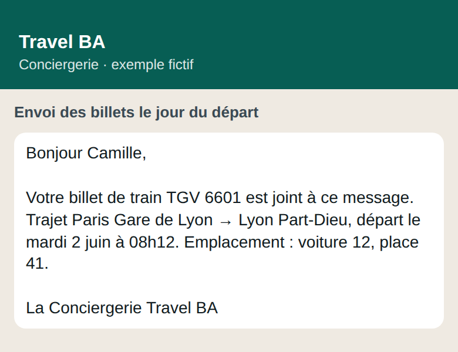

Voyageurs : Camille Martin

Placement : Place isolée ou côté fenêtre.

### 1. Commandé

Bot SNCF : Le bot a déjà acheté. Le cron du matin envoie le PDF, sans changer la visibilité de la carte.

**Agence**

Bonjour Camille,

Votre billet de train TGV 6601 est joint à ce message. Trajet Paris Gare de Lyon → Lyon Part-Dieu, départ le mardi 2 juin à 08h12. Emplacement : voiture 12, place 41.

La Conciergerie Travel BA

## Échange ou annulation après achat

Voyageurs : Camille Martin

Placement : Place isolée ou côté fenêtre.

### 1. Commandé

Bot SNCF : Le client écrit après l’émission. Le bot reçoit la demande d’échange. Les billets ne sont pas modifiés seuls.

**Client**

Je voudrais échanger mon billet

**Agence**

Je transmets ta demande d’échange. Les billets ne bougent pas tant que l’agence ne t’a pas confirmé.

### 2. Commandé

Bot SNCF : Même geste pour une annulation. Le bot vérifie les conditions. Le CRM n’annule pas le billet SNCF.

**Client**

Je souhaite annuler

**Agence**

Je transmets ta demande d’annulation. Les billets ne bougent pas tant que l’agence ne t’a pas confirmé.
