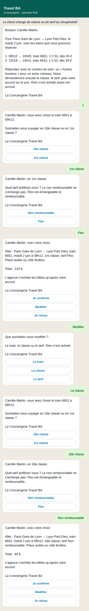
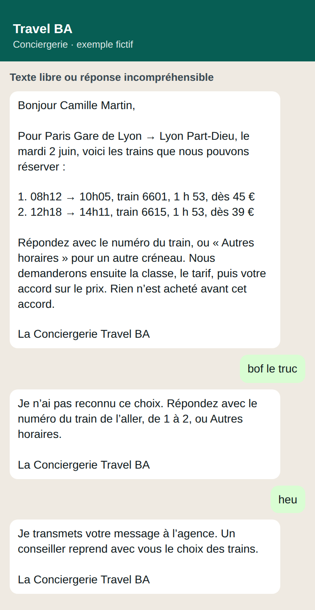
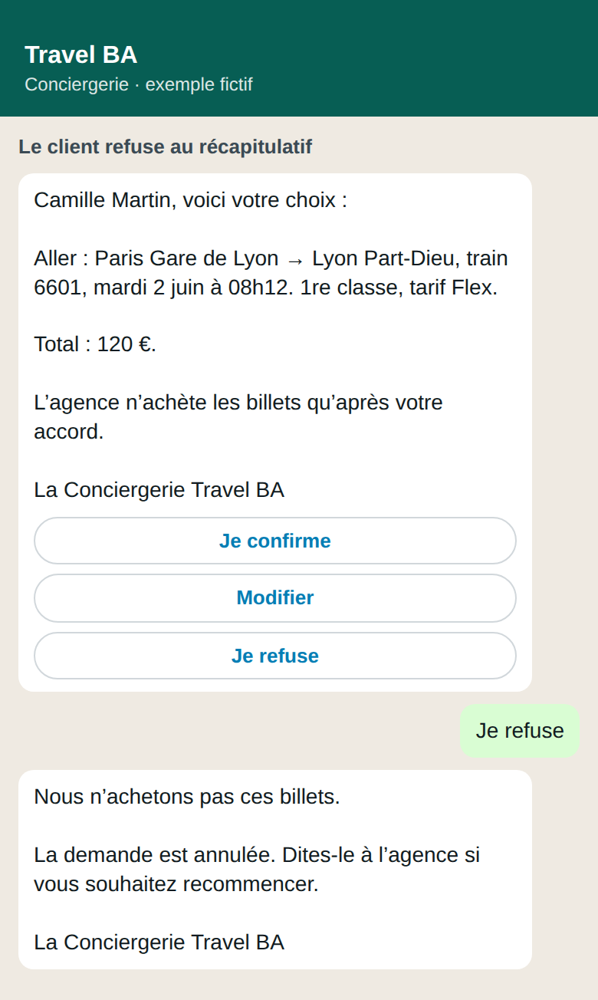
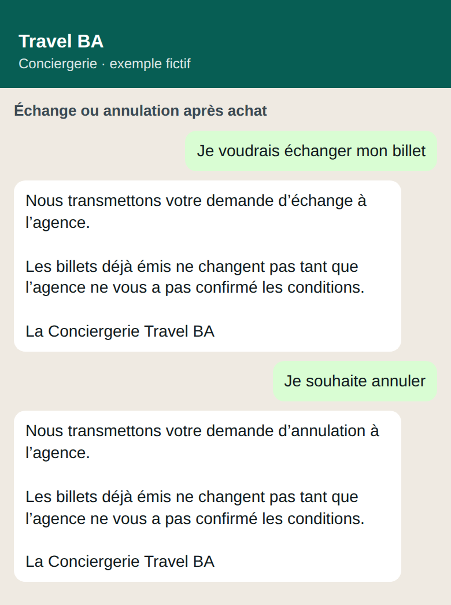

# Recette — billets de train WhatsApp

Parcours fictif. Aucun envoi réel. Les textes sont ceux du CRM, variables remplies.

Ordre : trains (aller, puis retour), classe, tarif, récapitulatif avec le prix, accord. Rien n’est acheté avant « Je confirme ».
Horaires proposés par défaut : aller à partir de 8h, retour à partir de 16h. Dates déduites de l’hôtel (lundi → mardi : aller lundi, retour mardi), modifiables.
Paiement : `creer_carte_pliant` sur le dossier, `trois_ds` faux. Le numéro n’est pas dans ces messages.

Les fils ci-dessous sont des images. Chaque fichier est dans `docs/recette-billets-train/`.

## Modèles

| Nom | Rôle |
| --- | --- |
| `train_proposition` | Texte numéroté, hors fenêtre de 24 h |
| `train_liste` | Liste interactive, dans la fenêtre ou trois trains |
| `train_classe` | Boutons 2de classe / 1re classe |
| `train_tarif` | Boutons Non remboursable / Flex |
| `train_accord` | Récapitulatif, Je confirme / Modifier / Je refuse |
| `train_modifier` | Le train / La classe / Le tarif |
| `train_billet` | PDF le matin du départ |

Une réponse incompréhensible repose la question une fois, puis la main passe à l’agence.
« Autres horaires », « plus tôt » ou « plus tard » renvoie la contrainte au bot SNCF.
Un délai (« je réfléchis ») garde les choix. À la relance, le bot resimule et le client confirme le nouveau prix.

## Aller simple, 1 voyageur

Voyageurs : Camille Martin

Placement : Place isolée ou côté fenêtre.

### 1. Propositions envoyées

Bot SNCF : Le bot a déposé deux trains aller. Il attend.

**Agence**

Bonjour Camille Martin,

Pour Paris Gare de Lyon → Lyon Part-Dieu, le mardi 2 juin, voici les trains que nous pouvons réserver :

1. 08h12 → 10h05, train 6601, 1 h 53, dès 45 €
2. 12h18 → 14h11, train 6615, 1 h 53, dès 39 €

Répondez avec le numéro du train, ou « Autres horaires » pour un autre créneau. Nous demanderons ensuite la classe, le tarif, puis votre accord sur le prix. Rien n’est acheté avant cet accord.

La Conciergerie Travel BA

### 2. Propositions envoyées

Bot SNCF : Rien. Le client choisit encore.

**Client**

le 1

**Agence**

Camille Martin, vous avez choisi le train 6601 à 08h12.

Souhaitez-vous voyager en 2de classe ou en 1re classe ?

La Conciergerie Travel BA

Boutons : 2de classe · 1re classe

### 3. Propositions envoyées

Bot SNCF : Rien.

**Client**

1re classe

**Agence**

Camille Martin, en 1re classe.

Quel tarif préférez-vous ? Le non remboursable ne s’échange pas. Flex est échangeable et remboursable.

La Conciergerie Travel BA

Boutons : Non remboursable · Flex

### 4. Propositions envoyées

Bot SNCF : Rien. L’achat attend l’accord.

**Client**

Flex

**Agence**

Camille Martin, voici votre choix :

Aller : Paris Gare de Lyon → Lyon Part-Dieu, train 6601, mardi 2 juin à 08h12. 1re classe, tarif Flex. Place isolée ou côté fenêtre.

Total : 120 €.

L’agence n’achète les billets qu’après votre accord.

La Conciergerie Travel BA

Boutons : Je confirme · Modifier · Je refuse

### 5. Choix reçu

Bot SNCF : Le bot achète le 6601 en 1re Flex, carte Pliant du dossier, sans 3DS.

**Client**

Je confirme

**Agence**

Camille Martin, votre choix est enregistré. Aller : Paris Gare de Lyon → Lyon Part-Dieu, train 6601, mardi 2 juin à 08h12. 1re classe, tarif Flex.

L’agence achète les billets et vous confirme.

La Conciergerie Travel BA

## Aller-retour, 2 voyageurs

Voyageurs : Hugo Bernard et Inès Bernard

Placement : Côte à côte ou face à face.

### 1. Propositions envoyées

Bot SNCF : Le bot a déposé l’aller et le retour pour Hugo Bernard et Inès Bernard. Placement transmis : Côte à côte ou face à face.

**Agence**

Bonjour Monsieur Bernard,

Pour Paris Gare de Lyon → Lyon Part-Dieu, le mardi 2 juin, voici les trains que nous pouvons réserver :

1. 08h12 → 10h05, train 6601, 1 h 53, dès 45 €
2. 12h18 → 14h11, train 6615, 1 h 53, dès 39 €

Répondez avec le numéro du train, ou « Autres horaires » pour un autre créneau. Nous demanderons ensuite la classe, le tarif, puis votre accord sur le prix. Rien n’est acheté avant cet accord.

La Conciergerie Travel BA

Liste :

- 08h12 6601 — Paris Gare de Lyon → Lyon Part-Dieu, 1 h 53, dès 45 €
- 12h18 6615 — Paris Gare de Lyon → Lyon Part-Dieu, 1 h 53, dès 39 €
- Autres horaires — Un autre créneau

### 2. Propositions envoyées

Bot SNCF : Pas d’achat.

**Client**

1

**Agence**

Bonjour Monsieur Bernard,

Pour Lyon Part-Dieu → Paris Gare de Lyon, le mercredi 3 juin, voici les trains que nous pouvons réserver :

1. 16h12 → 18h05, train 6630, 1 h 53, dès 42 €
2. 18h42 → 20h35, train 6644, 1 h 53, dès 48 €

Répondez avec le numéro du train, ou « Autres horaires » pour un autre créneau. Nous demanderons ensuite la classe, le tarif, puis votre accord sur le prix. Rien n’est acheté avant cet accord.

La Conciergerie Travel BA

Liste :

- 16h12 6630 — Lyon Part-Dieu → Paris Gare de Lyon, 1 h 53, dès 42 €
- 18h42 6644 — Lyon Part-Dieu → Paris Gare de Lyon, 1 h 53, dès 48 €
- Autres horaires — Un autre créneau

### 3. Propositions envoyées

Bot SNCF : Pas d’achat.

**Client**

1

**Agence**

Monsieur Bernard, vous avez choisi le train 6601 à 08h12.

Souhaitez-vous voyager en 2de classe ou en 1re classe ?

La Conciergerie Travel BA

Boutons : 2de classe · 1re classe

### 4. Propositions envoyées

Bot SNCF : Pas d’achat.

**Client**

2de classe

**Agence**

Monsieur Bernard, en 2de classe.

Quel tarif préférez-vous ? Le non remboursable ne s’échange pas. Flex est échangeable et remboursable.

La Conciergerie Travel BA

Boutons : Non remboursable · Flex

### 5. Propositions envoyées

Bot SNCF : Pas d’achat.

**Client**

Non remboursable

**Agence**

Monsieur Bernard, voici votre choix :

Aller : Paris Gare de Lyon → Lyon Part-Dieu, train 6601, mardi 2 juin à 08h12. Retour : Lyon Part-Dieu → Paris Gare de Lyon, train 6630, mercredi 3 juin à 16h12. 2de classe, tarif Non remboursable. Côte à côte ou face à face.

Total : 87 € par personne, 174 € pour 2 voyageurs.

L’agence n’achète les billets qu’après votre accord.

La Conciergerie Travel BA

Boutons : Je confirme · Modifier · Je refuse

### 6. Choix reçu

Bot SNCF : Le bot achète les deux trains, carte Pliant du dossier, sans 3DS, places selon la préférence.

**Client**

Je confirme

**Agence**

Monsieur Bernard, votre choix est enregistré. Aller : Paris Gare de Lyon → Lyon Part-Dieu, train 6601, mardi 2 juin à 08h12. Retour : Lyon Part-Dieu → Paris Gare de Lyon, train 6630, mercredi 3 juin à 16h12. 2de classe, tarif Non remboursable.

L’agence achète les billets et vous confirme.

La Conciergerie Travel BA

## Famille de 4, avec enfants

Voyageurs : Claire Morel, Marc Morel, Léa Morel (8 ans), Tom Morel (5 ans)

Placement : Carré, sinon quatre places alignées, sinon deux et deux l’une derrière l’autre. Avec enfant, salle basse prioritaire (TGV duplex).

### 1. Propositions envoyées

Bot SNCF : Le bot a déposé l’aller et le retour pour Claire Morel, Marc Morel, Léa Morel (8 ans), Tom Morel (5 ans). Placement transmis : Carré, sinon quatre places alignées, sinon deux et deux l’une derrière l’autre. Avec enfant, salle basse prioritaire (TGV duplex).

**Agence**

Bonjour Madame Morel,

Pour Paris Gare de Lyon → Lyon Part-Dieu, le mardi 2 juin, voici les trains que nous pouvons réserver :

1. 08h12 → 10h05, train 6601, 1 h 53, dès 45 €
2. 12h18 → 14h11, train 6615, 1 h 53, dès 39 €

Répondez avec le numéro du train, ou « Autres horaires » pour un autre créneau. Nous demanderons ensuite la classe, le tarif, puis votre accord sur le prix. Rien n’est acheté avant cet accord.

La Conciergerie Travel BA

Liste :

- 08h12 6601 — Paris Gare de Lyon → Lyon Part-Dieu, 1 h 53, dès 45 €
- 12h18 6615 — Paris Gare de Lyon → Lyon Part-Dieu, 1 h 53, dès 39 €
- Autres horaires — Un autre créneau

### 2. Propositions envoyées

Bot SNCF : Pas d’achat.

**Client**

1

**Agence**

Bonjour Madame Morel,

Pour Lyon Part-Dieu → Paris Gare de Lyon, le mercredi 3 juin, voici les trains que nous pouvons réserver :

1. 16h12 → 18h05, train 6630, 1 h 53, dès 42 €
2. 18h42 → 20h35, train 6644, 1 h 53, dès 48 €

Répondez avec le numéro du train, ou « Autres horaires » pour un autre créneau. Nous demanderons ensuite la classe, le tarif, puis votre accord sur le prix. Rien n’est acheté avant cet accord.

La Conciergerie Travel BA

Liste :

- 16h12 6630 — Lyon Part-Dieu → Paris Gare de Lyon, 1 h 53, dès 42 €
- 18h42 6644 — Lyon Part-Dieu → Paris Gare de Lyon, 1 h 53, dès 48 €
- Autres horaires — Un autre créneau

### 3. Propositions envoyées

Bot SNCF : Pas d’achat.

**Client**

1

**Agence**

Madame Morel, vous avez choisi le train 6601 à 08h12.

Souhaitez-vous voyager en 2de classe ou en 1re classe ?

La Conciergerie Travel BA

Boutons : 2de classe · 1re classe

### 4. Propositions envoyées

Bot SNCF : Pas d’achat.

**Client**

2de classe

**Agence**

Madame Morel, en 2de classe.

Quel tarif préférez-vous ? Le non remboursable ne s’échange pas. Flex est échangeable et remboursable.

La Conciergerie Travel BA

Boutons : Non remboursable · Flex

### 5. Propositions envoyées

Bot SNCF : Pas d’achat.

**Client**

Non remboursable

**Agence**

Madame Morel, voici votre choix :

Aller : Paris Gare de Lyon → Lyon Part-Dieu, train 6601, mardi 2 juin à 08h12. Retour : Lyon Part-Dieu → Paris Gare de Lyon, train 6630, mercredi 3 juin à 16h12. 2de classe, tarif Non remboursable. Carré, sinon quatre places alignées, sinon deux et deux l’une derrière l’autre. Avec enfant, salle basse prioritaire (TGV duplex).

Total : 87 € par personne, 348 € pour 4 voyageurs.

L’agence n’achète les billets qu’après votre accord.

La Conciergerie Travel BA

Boutons : Je confirme · Modifier · Je refuse

### 6. Choix reçu

Bot SNCF : Le bot achète les deux trains, carte Pliant du dossier, sans 3DS, places selon la préférence.

**Client**

Je confirme

**Agence**

Madame Morel, votre choix est enregistré. Aller : Paris Gare de Lyon → Lyon Part-Dieu, train 6601, mardi 2 juin à 08h12. Retour : Lyon Part-Dieu → Paris Gare de Lyon, train 6630, mercredi 3 juin à 16h12. 2de classe, tarif Non remboursable.

L’agence achète les billets et vous confirme.

La Conciergerie Travel BA

## Autres horaires, plus tôt ou plus tard

Voyageurs : Camille Martin

Placement : Place isolée ou côté fenêtre.

### 1. Propositions envoyées

Bot SNCF : Le bot a déposé les trains à partir de 8h et 16h.

**Agence**

Bonjour Camille Martin,

Pour Paris Gare de Lyon → Lyon Part-Dieu, le mardi 2 juin, voici les trains que nous pouvons réserver :

1. 08h12 → 10h05, train 6601, 1 h 53, dès 45 €
2. 12h18 → 14h11, train 6615, 1 h 53, dès 39 €

Répondez avec le numéro du train, ou « Autres horaires » pour un autre créneau. Nous demanderons ensuite la classe, le tarif, puis votre accord sur le prix. Rien n’est acheté avant cet accord.

La Conciergerie Travel BA

Liste :

- 08h12 6601 — Paris Gare de Lyon → Lyon Part-Dieu, 1 h 53, dès 45 €
- 12h18 6615 — Paris Gare de Lyon → Lyon Part-Dieu, 1 h 53, dès 39 €
- Autres horaires — Un autre créneau

### 2. Recherche en cours

Bot SNCF : Le bot relance une recherche aller avant 7h. Il ne commande pas.

**Client**

Plus tôt, avant 7h

**Agence**

Nous cherchons d’autres trains pour l’aller, Plus tôt, avant 7h.

La Conciergerie Travel BA

### 3. Recherche en cours

Bot SNCF : Même geste pour le retour : « plus tard, après 19h » renvoie la contrainte du retour.

## Le client change de classe ou de tarif au récapitulatif

Voyageurs : Camille Martin

Placement : Place isolée ou côté fenêtre.

### 1. Propositions envoyées

Bot SNCF : Trains déposés.

**Agence**

Bonjour Camille Martin,

Pour Paris Gare de Lyon → Lyon Part-Dieu, le mardi 2 juin, voici les trains que nous pouvons réserver :

1. 08h12 → 10h05, train 6601, 1 h 53, dès 45 €
2. 12h18 → 14h11, train 6615, 1 h 53, dès 39 €

Répondez avec le numéro du train, ou « Autres horaires » pour un autre créneau. Nous demanderons ensuite la classe, le tarif, puis votre accord sur le prix. Rien n’est acheté avant cet accord.

La Conciergerie Travel BA

### 2. Propositions envoyées

Bot SNCF : Pas d’achat.

**Client**

1

**Agence**

Camille Martin, vous avez choisi le train 6601 à 08h12.

Souhaitez-vous voyager en 2de classe ou en 1re classe ?

La Conciergerie Travel BA

Boutons : 2de classe · 1re classe

### 3. Propositions envoyées

Bot SNCF : Pas d’achat.

**Client**

1re classe

**Agence**

Camille Martin, en 1re classe.

Quel tarif préférez-vous ? Le non remboursable ne s’échange pas. Flex est échangeable et remboursable.

La Conciergerie Travel BA

Boutons : Non remboursable · Flex

### 4. Propositions envoyées

Bot SNCF : Pas d’achat.

**Client**

Flex

**Agence**

Camille Martin, voici votre choix :

Aller : Paris Gare de Lyon → Lyon Part-Dieu, train 6601, mardi 2 juin à 08h12. 1re classe, tarif Flex. Place isolée ou côté fenêtre.

Total : 120 €.

L’agence n’achète les billets qu’après votre accord.

La Conciergerie Travel BA

Boutons : Je confirme · Modifier · Je refuse

### 5. Propositions envoyées

Bot SNCF : Le bot n’achète pas. Le client change la classe.

**Client**

Modifier

**Agence**

Que souhaitez-vous modifier ?

Le train, la classe ou le tarif. Rien n’est acheté.

La Conciergerie Travel BA

Boutons : Le train · La classe · Le tarif

### 6. Propositions envoyées

Bot SNCF : Rien.

**Client**

La classe

**Agence**

Camille Martin, vous avez choisi le train 6601 à 08h12.

Souhaitez-vous voyager en 2de classe ou en 1re classe ?

La Conciergerie Travel BA

Boutons : 2de classe · 1re classe

### 7. Propositions envoyées

Bot SNCF : Rien.

**Client**

2de classe

**Agence**

Camille Martin, en 2de classe.

Quel tarif préférez-vous ? Le non remboursable ne s’échange pas. Flex est échangeable et remboursable.

La Conciergerie Travel BA

Boutons : Non remboursable · Flex

### 8. Propositions envoyées

Bot SNCF : Nouveau récapitulatif. L’achat attend encore l’accord.

**Client**

Non remboursable

**Agence**

Camille Martin, voici votre choix :

Aller : Paris Gare de Lyon → Lyon Part-Dieu, train 6601, mardi 2 juin à 08h12. 2de classe, tarif Non remboursable. Place isolée ou côté fenêtre.

Total : 45 €.

L’agence n’achète les billets qu’après votre accord.

La Conciergerie Travel BA

Boutons : Je confirme · Modifier · Je refuse

## Texte libre ou réponse incompréhensible

Voyageurs : Camille Martin

Placement : Place isolée ou côté fenêtre.

### 1. Propositions envoyées

Bot SNCF : Trains déposés.

**Agence**

Bonjour Camille Martin,

Pour Paris Gare de Lyon → Lyon Part-Dieu, le mardi 2 juin, voici les trains que nous pouvons réserver :

1. 08h12 → 10h05, train 6601, 1 h 53, dès 45 €
2. 12h18 → 14h11, train 6615, 1 h 53, dès 39 €

Répondez avec le numéro du train, ou « Autres horaires » pour un autre créneau. Nous demanderons ensuite la classe, le tarif, puis votre accord sur le prix. Rien n’est acheté avant cet accord.

La Conciergerie Travel BA

### 2. Propositions envoyées

Bot SNCF : Rien. La question est reposée.

**Client**

bof le truc

**Agence**

Je n’ai pas reconnu ce choix. Répondez avec le numéro du train de l’aller, de 1 à 2, ou Autres horaires.

La Conciergerie Travel BA

### 3. Propositions envoyées

Bot SNCF : La main passe à l’agence. Le bot n’achète pas.

**Client**

heu

**Agence**

Je transmets votre message à l’agence. Un conseiller reprend avec vous le choix des trains.

La Conciergerie Travel BA

## Aucune réponse, puis relance avec un prix plus élevé

Voyageurs : Camille Martin

Placement : Place isolée ou côté fenêtre.

### 1. Propositions envoyées

Bot SNCF : Récapitulatif envoyé. Pas de réponse : la demande reste en propositions, les choix restent.

**Agence**

Camille Martin, voici votre choix :

Aller : Paris Gare de Lyon → Lyon Part-Dieu, train 6601, mardi 2 juin à 08h12. 1re classe, tarif Flex. Place isolée ou côté fenêtre.

Total : 120 €.

L’agence n’achète les billets qu’après votre accord.

La Conciergerie Travel BA

Boutons : Je confirme · Modifier · Je refuse

### 2. En attente

Bot SNCF : Le bot n’achète pas. Les choix restent enregistrés.

**Client**

Je réfléchis, demain

**Agence**

Nous gardons votre choix. Rien n’est acheté.

Quand vous reprendrez, le prix sera revérifié avant l’achat.

La Conciergerie Travel BA

### 3. Prix à reconfirmer

Bot SNCF : Le bot refait une simulation SNCF.

**Client**

On reprend

**Agence**

Nous vérifions le prix auprès de la SNCF et nous vous le confirmons avant d’acheter.

La Conciergerie Travel BA

### 4. Propositions envoyées

Bot SNCF : Le bot a renvoyé le prix augmenté. Le CRM redemande l’accord. Sans « Je confirme », pas d’achat.

**Agence**

Camille Martin, voici votre choix :

Aller : Paris Gare de Lyon → Lyon Part-Dieu, train 6601, mardi 2 juin à 08h12. 1re classe, tarif Flex.

Total : 135 € (auparavant 120 €).

L’agence n’achète les billets qu’après votre accord.

La Conciergerie Travel BA

Boutons : Je confirme · Modifier · Je refuse

## Train complet ou plus disponible au moment d’acheter

Voyageurs : Camille Martin

Placement : Place isolée ou côté fenêtre.

### 1. Choix reçu

Bot SNCF : Le bot tente l’achat et voit que le 6601 est complet.

**Agence**

Camille Martin, votre choix est enregistré. Aller train 6601.

L’agence achète les billets et vous confirme.

La Conciergerie Travel BA

### 2. Recherche en cours

Bot SNCF : Le bot prévient le CRM. Le CRM écrit au client et redemande une recherche. Rien n’est débité.

**Agence**

Le train 6601 n’est plus disponible. Nous n’achetons rien.

La recherche reprend. Nous vous enverrons d’autres horaires.

La Conciergerie Travel BA

## Le client refuse au récapitulatif

Voyageurs : Camille Martin

Placement : Place isolée ou côté fenêtre.

### 1. Propositions envoyées

Bot SNCF : Récapitulatif en attente d’accord.

**Agence**

Camille Martin, voici votre choix :

Aller : Paris Gare de Lyon → Lyon Part-Dieu, train 6601, mardi 2 juin à 08h12. 1re classe, tarif Flex.

Total : 120 €.

L’agence n’achète les billets qu’après votre accord.

La Conciergerie Travel BA

Boutons : Je confirme · Modifier · Je refuse

### 2. Annulé

Bot SNCF : Le bot n’achète pas. La demande est annulée.

**Client**

Je refuse

**Agence**

Nous n’achetons pas ces billets.

La demande est annulée. Dites-le à l’agence si vous souhaitez recommencer.

La Conciergerie Travel BA

## Envoi des billets le jour du départ

Voyageurs : Camille Martin

Placement : Place isolée ou côté fenêtre.

### 1. Commandé

Bot SNCF : Le bot a déjà acheté. Le cron du matin envoie le PDF, sans changer la visibilité de la carte.

**Agence**

Bonjour Camille,

Votre billet de train TGV 6601 est joint à ce message. Trajet Paris Gare de Lyon → Lyon Part-Dieu, départ le mardi 2 juin à 08h12. Emplacement : voiture 12, place 41.

La Conciergerie Travel BA

## Échange ou annulation après achat

Voyageurs : Camille Martin

Placement : Place isolée ou côté fenêtre.

### 1. Commandé

Bot SNCF : Le client écrit après l’émission. Le bot reçoit la demande d’échange. Les billets ne sont pas modifiés seuls.

**Client**

Je voudrais échanger mon billet

**Agence**

Nous transmettons votre demande d’échange à l’agence.

Les billets déjà émis ne changent pas tant que l’agence ne vous a pas confirmé les conditions.

La Conciergerie Travel BA

### 2. Commandé

Bot SNCF : Même geste pour une annulation. Le bot vérifie les conditions. Le CRM n’annule pas le billet SNCF.

**Client**

Je souhaite annuler

**Agence**

Nous transmettons votre demande d’annulation à l’agence.

Les billets déjà émis ne changent pas tant que l’agence ne vous a pas confirmé les conditions.

La Conciergerie Travel BA
